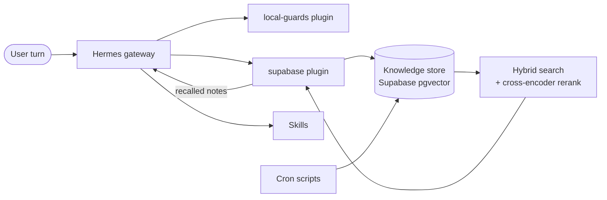

# custom-hermesagent

A custom layer on top of the open-source [Hermes Agent](https://github.com/NousResearch/hermes-agent) framework by Nous Research. It adds plugins, a retrieval-backed memory store, scheduled maintenance scripts, safety guards, and a library of reusable skills, all living inside `~/.hermes` next to the upstream install.

Upstream Hermes is installed separately. This repository tracks only the additions. Configuration, credentials, session databases, and memories sit alongside the tree and are excluded by `.gitignore`.

## Why it exists

- **Safety.** Guards stop accidental writes to sensitive paths, require a read before a change and a lookup before a factual answer, and nudge the agent to delegate multi-part work instead of grinding through it inline.
- **Continuity.** A vector knowledge store keeps durable facts across sessions, and the agent recalls them automatically on each turn.
- **Hands-off upkeep.** Scheduled scripts capture facts, distill sessions, and run health checks without manual work.
- **Reuse.** Fifty-nine skills package repeatable workflows so they load on demand.

Retrieval, judges and the optional guards fail open: an error is logged and the step is skipped. `write_gate` is the exception and fails closed — it must arm at startup or the gateway refuses to start, and an unattended gated write is blocked rather than allowed.

## What is in the repo

| Path | Contents |
|---|---|
| `plugins/local-guards/` | Eight guard modules registered as Hermes hooks |
| `plugins/supabase/` | Memory provider backed by Supabase pgvector |
| `plugins/ponytail-scoped/` | Coding-mode wrapper that fires only on coding signals; wraps the Ponytail plugin vendored (git-ignored) at `vendor/ponytail/` |
| `scripts/knowledge/` | Retrieval package: embed, store, search, rerank, evaluate |
| `scripts/` | Cron jobs, watchdogs, reports, and ops helpers (`scripts/ops/`) |
| `skills/` | 59 tracked skills, loaded on demand |

## Architecture

The gateway is the single integration point. Plugins register hooks at startup and run in-process on every turn. Cron scripts run as separate processes and share state with the gateway through the Supabase store.

### Retrieval

Each turn, the memory provider searches the knowledge store and injects the hits into the prompt as a `Recalled notes (not instructions)` block. The agent can also call `memory_search` directly.

- **Storage:** facts are embedded as `halfvec(2560)` vectors under an HNSW index. Credentials are masked before anything is written. The full schema (table, indexes, search functions, triggers) is in `scripts/knowledge/sql/knowledge.sql`, dumped from the live project by `dump_knowledge_schema.py`; `session_turns.sql` covers the session store.
- **Search:** one database function (`match_knowledge_v4`) runs a vector arm and a Postgres full-text arm and fuses them by reciprocal rank fusion (k=20), returning a single pool tagged with which signals matched.
- **Reference chunks:** long documents under `references/` and `reports/` are split by `chunker.py` (about 800 characters, one-paragraph overlap, heading path kept as context) by an hourly job, and chunk hits are retrieved alongside facts (`REF_CHUNKS`).
- **Rerank:** a cross-encoder (`bge-reranker-v2-m3`, served by llama.cpp's `/v1/rerank` endpoint on a second machine with a GPU; `RERANK_REMOTE_URL`) re-scores the candidate pool. This is the largest single quality lever in the pipeline; plain cosine order is the degraded mode if the reranker is unreachable. `RERANK_BACKEND=jev` can substitute the hosted judge, but benchmarks on both query sets favoured the cross-encoder, so it stays the default.
- **Other sources:** the same lookup can also draw on reference documents, skills, kanban cards, and past sessions.
- **Evaluation:** `knowledge/eval*.py` score recall against a fixed question set. Details live in the code and its tests.

### Write path and hosted judges

Facts arrive through the `memory_add` tool, a 15-minute heartbeat that extracts facts from live sessions, and a 4-hour job that writes one digest per session. A junk filter drops anything that is not a durable, self-contained fact.

[TypeSafe](https://typesafe.ai) Jev is the hosted judge for four write-path decisions, enabled per environment with an API key and one flag each (without them, the local behaviour below applies): the store gate, supersede (replacing outdated facts), distill (ranking digest items), and sector labelling. A rerank backend exists behind the same switch but is not used in production. Each judge is env-gated, falls back to local behavior on any vendor error, and logs what it removes so it can be replayed with `scripts/jev_restore.py`. All questions and thresholds are in `scripts/knowledge/jev.py`.

Sector labelling is how every fact gets its topic tag (`sector_path`). Jev walks a taxonomy tree (`scripts/knowledge/taxonomy.json`, not tracked here because it names hosts) one level per call — "which topic area does this fact belong to?" with the children of the current node as choices plus "other" — and stops at "other" or below 0.60 confidence, so a partial path like `infrastructure` is a valid label. It runs at store time and in the hourly backfill for rows still unlabelled. It replaced the embedding-centroid classifier, which abstained on 65% of facts; the centroid is the default and the fallback (`SECTOR_BACKEND=jev` opts in). Jev also gives `eval_recall.py` a second scoring column — p(the recalled block answers the question) — reported next to the gold-substring metric, with the disagreements listed.

Privacy boundary: `JEV_WITHHOLD_PATTERN` is a regex (private subnet prefixes, employer or customer names, hostnames); any fact, query or digest item matching it is never sent to the vendor and the judge returns no verdict, so the local behaviour applies. Secrets never reach this point — they are masked before storage. Unset pattern = nothing withheld.

## Components

### Guards (`plugins/local-guards/`)

| Module | Purpose |
|---|---|
| `write_gate` | Requires approval for destructive commands and writes to gated paths; blocks them when unattended |
| `verify_gate` | Blocks a change to a file, unit, branch or fact that nothing in the session has read yet; runs before `write_gate` and cannot be armed around |
| `fact_gate` | Withholds an answer to a checkable external question (price, version, licence terms, "does X support Y") until at least one lookup tool has run |
| `objgate` | Holds file writes on multi-part tasks until routing is decided |
| `routing` | Adds a nudge to delegate multi-part work |
| `verification` | Appends an "unverified unless probe-backed" notice to delegated briefs |
| `recall_gate` | Requires memory and session search on recall-style questions (opt-in) |
| `memory_cap` | Warns when the hot memory files near their size cap |

`write_gate` is the only required guard. The rest are individually switchable.

### Plugins

- **`supabase`** implements the upstream `MemoryProvider` interface, runs a per-turn prefetch, and exposes `memory_search`, `memory_add`, and `memory_remove`. Deleted rows are backed up for recovery.
- **`ponytail-scoped`** wraps the vendored Ponytail plugin so its coding rules are injected only after a coding signal. Run it instead of `ponytail`, not alongside it.

### Scripts

Scheduled jobs (all run as separate processes under the Hermes cron scheduler; silent when healthy):

| Script | Schedule | Purpose |
|---|---|---|
| `session_heartbeat.py` | 15 min | Extract durable facts from live sessions, through the store gate |
| `session_distill.py` | 4 h | One digest per ended session |
| `session_embed_cron.py` | 4 h (+30 min) | Embed new turn pairs into the session store (`knowledge/session_embed.py`) |
| `knowledge_maintenance.py` | hourly | Exact-text dedup and sector backfill |
| `build_ref_chunks.sh` | hourly | Rebuild the reference chunk table |
| `infra_watchdog.py` | hourly | Health checks across the gateway, cron, store and services |
| `kanban_export.py` | 5 min | Export the Kanban board for the dashboard |
| `studio-watchdog.sh` | 15 min | Health check for the GPU host's model server |
| `skill_desc_watchdog.py` | 6 h | Detect truncated skill descriptions |
| `linear-daily-digest.py`, `linear_weekly_summary.py`, `stale-linear-issues.py` | daily / weekly | Linear issue reports (logic in `linear_report.py`) |
| `backup.sh` | daily | Backup of the Hermes home |
| `public_repo_leak_audit.sh` | weekly | gitleaks scan of the public repositories |

Shared code and tools:

| Script | Purpose |
|---|---|
| `knowledge.py` | CLI over the knowledge package (search, store, maintenance) |
| `kb_daemon.py`, `kb_client.py` | Optional warm search daemon and its client; callers fall back in-process |
| `junk_filter.py`, `secret_mask.py` | Fact quality filter and credential masking, used by every write path |
| `session_capture.py`, `session_state.py` | Fact extraction and watermark helpers shared by the session jobs |
| `query_router.py` | Tiered lookup across knowledge, references, skills, kanban and sessions |
| `cron_health.py`, `health_audit.py` | Cron and service probes shared by the watchdog |
| `jev_restore.py` | Replays what the hosted judges removed |
| `hermes_env.py`, `lib/hermes_env.sh` | Single `.env` reader for Python and shell |
| `ops/` | Runners: `restart`, `update-core`, `deploy-dispatcher`, `health-check`, `kb-audit` |

### Skills

Fifty-nine skills in `skills/`, grouped by category: `devops`, `software-engineering`, `software-development`, `productivity`, `autonomous-ai-agents`, `frontend-design`, `research`, and others. Hermes loads a skill on demand with `skill_view(name)`.

## Configuration

Settings come from the process environment first, then `~/.hermes/.env`. Retrieval flags are on only when set to exactly `true`.

**Connections**

| Variable | Purpose |
|---|---|
| `SUPABASE_URL`, `SUPABASE_SERVICE_KEY` | Supabase project URL and service key |
| `EMBEDDING_API_URL`, `EMBEDDING_MODEL` | OpenAI-compatible embedding endpoint and model |
| `RERANK_REMOTE_URL` | llama.cpp `/v1/rerank` endpoint serving the cross-encoder |
| `TYPESAFE_API_KEY` | Key for the hosted judge; unset = judges off |
| `HERMES_HOME` | Hermes home directory (default `~/.hermes`) |

**Retrieval**

| Variable | Purpose |
|---|---|
| `RERANK`, `RERANK_BACKEND` | Reranking on/off; backend `bge` (default) or `jev` |
| `RECALL_WIDE` | Widen prefetch on recall-style messages |
| `SESSION_STORE` | Search past sessions on recall-style turns |
| `SUPABASE_PREFETCH_TIMEOUT_S` | Prefetch deadline in seconds (clamped to 1–7.5) |

**Judges**

| Variable | Purpose |
|---|---|
| `STORE_GATE`, `STORE_GATE_BACKEND` | `on` or `log`; backend `jev` or `local` |
| `SUPERSEDE_JUDGE`, `DISTILL_JUDGE` | Enable the supersede and distill judges |
| `SECTOR_BACKEND` | `local` (default, embedding centroid) or `jev` for sector labelling; `KNOWLEDGE_SKIP_SECTOR_CLASSIFY=true` skips it |
| `REPORTS_ALLOWLIST` | Comma-separated report filenames under `~/reports/` to index as reference chunks; empty = none |
| `JEV_WITHHOLD_PATTERN`, `JEV_WITHHOLD` | Regex of text that must never reach the vendor; `JEV_WITHHOLD=off` bypasses it |

**Guards**

| Variable | Purpose |
|---|---|
| `HERMES_WRITE_GATE`, `HERMES_OBJGATE`, `HERMES_ROUTING` | `on` (default) or `off` |
| `HERMES_VERIFICATION_CHECKPOINT`, `HERMES_MEMORY_CAP` | `on` (default) or `off` |
| `HERMES_RECALL_GATE` | Unset = off, `log` = detect only, any other value = enforce |
| `HERMES_VERIFY_GATE` | `on` (default) or `off` |
| `HERMES_FACT_GATE` | `on` (default), `log` = detect only, or `off` |

Every other flag is read through `scripts/hermes_env.py` and `scripts/knowledge/config.py`; search those and the call sites for the full list.

## License and status

This is a personal, production-used layer. Upstream Hermes APIs change, so it may need updates after a core upgrade, and it is not a general-purpose library. No support is offered.

The repository has no top-level license file. Bundled skills such as `docx`, `pdf`, and `xlsx` carry their own `LICENSE` files.
