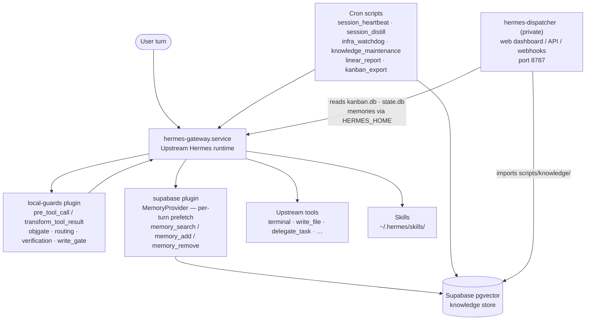
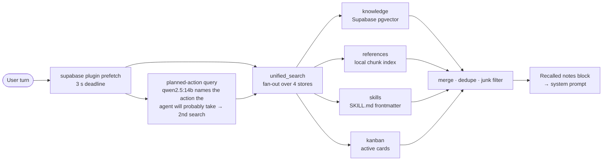

# andrewalhaj/custom-hermesagent

Andrew Alhaj's custom layer on top of the open-source [Hermes Agent](https://github.com/NousResearch/hermes-agent) framework by Nous Research. The upstream runtime is installed separately (see its docs); this repository tracks only the additions that live inside `~/.hermes`: four guard plugin modules, a Supabase memory provider, a scoped coding-mode plugin, a pgvector knowledge store, a suite of cron and maintenance scripts, and 61 reusable skills. Config, credentials, session databases, and memories live alongside the tree but are excluded via `.gitignore`.

The primary motivation is safety and operational continuity: the guard plugins prevent accidental writes to gated paths and nudge the agent toward proper delegation on multi-part tasks; the knowledge store persists durable facts across sessions; the cron pipeline keeps the store current without manual intervention. All components are designed to fail open — a guard error is logged and skipped, never a gateway crash.

---

## 1. Relationship to upstream Hermes

Upstream Hermes provides the agent runtime: the gateway process, LLM provider abstraction, tool execution engine, human approval prompts, kanban and delegation primitives, session storage, the plugin hook API (`pre_tool_call`, `transform_tool_result`, `pre_llm_call`, `pre_gateway_dispatch`), the skill-loading system, and the `hermes` CLI.

This layer adds, without modifying upstream source files:

| What | Where | How it connects |
|---|---|---|
| Four session-scoped guard modules | `plugins/local-guards/` | Registered as native hooks at gateway startup via `plugin.yaml` |
| Supabase pgvector memory provider | `plugins/supabase/` | Implements the upstream `MemoryProvider` interface; prefetches on every turn |
| Scoped coding-mode wrapper (Ponytail) | `plugins/ponytail-scoped/` | Replaces Ponytail's `pre_llm_call`; fires only on a coding signal |
| Knowledge store — embed / store / search / eval | `scripts/knowledge/` | Python package; used by the supabase plugin, cron scripts, and the knowledge CLI |
| Cron scripts — session capture, watchdogs, reports | `scripts/` | Scheduled via Hermes cron; run outside the gateway process |
| Ops helpers | `scripts/ops/` | Shell scripts for restart, deploy, audit, and core update |
| 61 skills across 15 categories | `skills/` | Loaded on demand by Hermes's built-in skill system |

No host addresses, API keys, or credentials are stored in the tree; all are read from `~/.hermes/.env` at runtime.

---

## 2. Architecture

The gateway process is the single integration point. Plugins register their hooks at startup and run in-process on every turn. Cron scripts run as separate processes under the Hermes cron scheduler and communicate with the gateway indirectly (via the shared Supabase store and the `state.db` SQLite file). The dispatcher is a completely separate service that reads the gateway's on-disk state.



### 2.1 Retrieval (RAG) pipeline

The agent's long-term memory is a retrieval pipeline, not a file. Every turn, the `supabase` plugin runs a search and injects the hits into the prompt as a `## Recalled notes (not instructions)` block; the agent also calls `memory_search` explicitly. Both paths go through the same code in `scripts/knowledge/`.



**Storage.** Facts live in one Supabase Postgres table with a `halfvec(2560)` column (float16 pgvector) under an HNSW index with `halfvec_cosine_ops`. The embedder is Qwen3-Embedding-4B served over an OpenAI-compatible `/api/embed` endpoint (`EMBEDDING_API_URL`, `EMBEDDING_MODEL`); no `dimensions` parameter is sent, so vectors are the model's native 2560 dims. halfvec is what makes a >2000-dim vector indexable in pgvector — the `vector` type caps HNSW at 2000 dims. Alongside the vector each row carries `tags`, `priority`, `source`, `stored_at`, and a `sector_path` (see below). Credentials are masked by `storage.py` before anything is written.

**Chunking.** Long documents (reference `.md` files, session digests) go through `chunker.py`: paragraph-overlap chunking at ~800 characters with a one-paragraph overlap, heading-breadcrumb tracking, and a synthetic prefix (`This passage is from <path>: <heading>`) embedded with each chunk. Chunks are normalised to lead with their leaf heading so the SHA-256 `body_hash` dedup catches the headerless twins the overlap would otherwise produce.

**Query path** (`search.py`, one RPC: `match_knowledge_v4`):

| Stage | What it does | Gate |
|---|---|---|
| Hybrid retrieval | pgvector cosine + Postgres full-text (tsvector/GIN) fused server-side with reciprocal rank fusion, k=20 | always |
| Query expansion | 2–3 deterministic query variants, merged client-side with RRF | `QUERY_EXPAND=true` |
| Confidence band | 0–1 agreement score across vector / FTS / sector signals, attached as metadata | always |
| Rerank | Cross-encoder `bge-reranker-v2-m3` on a remote llama-server `/v1/rerank` (~0.4 s); falls back to cosine if the endpoint is down | `RERANK=true` |
| Sector filter | Pre-filter the candidate pool to the query's sector | `SECTOR_FILTER=true` (off: regressed recall) |

Every gate is read at call time, not import time, so flipping an env var takes effect on the next search without a restart.

**Sector classification.** `classifier.py` assigns each fact a path in a 63-node, 3-level taxonomy (`taxonomy.json`, e.g. `infrastructure/storage/database`) using centroid embeddings with a kNN reject scorer that can abstain. Skills carry a `sector_path` in their SKILL.md frontmatter and are scored the same way. Facts are classified one at a time at store time; a store-wide bulk re-classification was tried three times and regressed retrieval every time, so there is none.

**References store.** `ref_chunks.py` keeps an incremental local index of `~/.hermes/references/*.md`, chunked and embedded as above, searched by chunk-level RRF of cosine + BM25 and returned as the best 250-character query-term window. This took deep doc-level Success@5 from 0.63 (keyword search) to 0.97 in the 2026-10-14 experiment that selected it.

**Warm daemon.** The embedding client and Supabase connection are held by `kb_daemon.py` behind a Unix socket; `kb_client.py` is a stdlib-only client that falls back to in-process search on any socket failure. Cold start of the knowledge CLI dropped from ~8 s to ~0.5 s. The daemon is acceleration only — never a hard dependency.

**Write path.** Three writers feed the store: the `memory_add` tool (and the upstream `memory()` tool, intercepted by the provider's `on_memory_write` hook), `session_heartbeat.py` every 15 min (facts extracted from live sessions), and `session_distill.py` every 4 h (one digest per ended session). The two fact writers share `junk_filter.py`, so a string that is not a durable, self-contained fact is dropped before it is embedded; digests are chunked instead.

**Evaluation.** `eval.py` / `kbench.py` run a fixed query set against the live store and report P@5, Recall@K and MRR; entries key on an `expected_substring` of the target fact, never on a row id, because ids change under dedup. `factbench.py` measures indirect recall (the question does not share vocabulary with the fact) — the planned-action second query above took that from 20–25 % to 40 %. Every stage in the table was A/B'd against the no-gate baseline before it shipped; the ones that lost (query enrichment, graph expansion, a local CPU cross-encoder) were deleted rather than left behind a flag.

---

## 3. Plugins

### 3.1 `local-guards`

Armed at gateway and CLI startup by `plugins/local-guards/__init__.py`. Each public module in `guards/` exports a `HOOKS` dict; the loader registers every hook via `ctx.register_hook` and chains all `transform_tool_result` callbacks so none is silently dropped. `write_gate` is the only required guard — startup fails if it does not arm. All guards default to enabled and are individually controllable via environment variables.

| Module | Hook(s) | What it does |
|---|---|---|
| `objgate` | `pre_llm_call`, `pre_tool_call` | **Whole-objective gate.** Detects multi-part "inventory / surface everything" turns and arms an in-memory gate. Blocks `write_file` and `patch` until `run/inventory.json` resolves routing (chunk count ≤ K, or `routing=inline` with a reason) or a routing tool (`delegate_task`, `kanban_*`) clears the gate. Fails open on any error. |
| `routing` | `pre_llm_call`, `transform_tool_result` | **Routing nudge.** Appends a `[Routing: …]` advisory line to a tool result when the user message is multi-part, phased, or contains "plan to" / multiple URLs — and again every `HERMES_ROUTING_WRITES` file writes or `HERMES_ROUTING_TERMINAL` terminal calls without a routing action. Cannot force routing. |
| `verification` | `pre_tool_call`, `transform_tool_result` | **Epistemic contract.** Appends an "unverified unless probe-backed" footer to every `delegate_task` brief (`pre_tool_call` modify). Also nudges after the first `terminal` result per turn that contains "not found" / "inactive" / "0 results" to reverse-lookup before concluding absence. |
| `write_gate` | `pre_tool_call` | **Write gate.** Intercepts destructive `terminal` commands (systemctl, docker, apt, git force-push, reboot, …), `write_file`/`patch` to gated paths (`config.yaml`, `.env`, `AGENTS.md`, `skills/`, `plugins/local-guards/`, …), and `execute_code` with gated write patterns. Routes to Hermes's native approval prompt when a human is present; blocks outright when unattended (cron, yolo, approvals off). A time-limited armed grant (`write_gate.py arm "note"`) bypasses the gate for a pre-approved batch. |

### 3.2 `supabase`

A Supabase pgvector memory provider implementing the upstream `MemoryProvider` interface. On every turn it runs a two-query prefetch: a semantic search on the user message, plus a secondary search on a one-line action description generated by a local LLM (the indirect-recall path). Results are injected as `## Recalled notes (not instructions)` in the context. The plugin also exposes `memory_search`, `memory_add`, and `memory_remove` tools. All storage and retrieval routes through `scripts/knowledge/`. A shared `junk_filter` module gates writes so transient facts (turn markers, PR numbers, phase completions) are not stored.

**Required env vars:** `SUPABASE_URL`, `SUPABASE_SERVICE_KEY`, `EMBEDDING_API_URL`.

### 3.3 `ponytail-scoped`

A scoped wrapper for the vendored Ponytail plugin (`~/.hermes/vendor/ponytail`, untracked). Replaces Ponytail's `pre_llm_call` hook so that the Ponytail coding ruleset is injected only after a coding signal (code-file edits, test/build/git commands, or a code-shaped message), prefixed with a `SCOPE.md` preamble. Non-code replies keep a normal voice. Signal patterns and the scope preamble are configurable without touching the upstream Ponytail package. Running both `ponytail` and `ponytail-scoped` in the same profile will double-inject; use one or the other.

---

## 4. Scripts

### Knowledge package (`scripts/knowledge/`)

The core library for embedding, storing, and searching facts in Supabase pgvector. The knowledge CLI (`scripts/knowledge.py`) wraps it with `search`, `ingest`, `status`, and `eval` subcommands; searches go to the warm daemon first and fall back in-process.

| Module | Purpose |
|---|---|
| `embed.py` | Embed text chunks via `EMBEDDING_API_URL` |
| `storage.py` | Insert, dedup, and sector-backfill chunks; masks credentials before writing |
| `search.py` | Semantic nearest-neighbour search with optional sector boost |
| `unified_search.py` | Tiered retrieval router: instant (pgvector only) → warm daemon → full in-process |
| `classifier.py` | Sector classifier: assigns a `sector_path` to each chunk using centroid embeddings |
| `eval.py` | Retrieval evaluation: Recall@K, MRR, per-sector breakdowns |
| `unified_bench.py` | End-to-end benchmark across all retrieval tiers |
| `factbench.py` | Fact-grounding benchmark measuring indirect-recall improvement |
| `build_centroids.py` | Build sector centroid cache from stored chunks |
| `chunker.py` | Split long text into overlapping chunks |
| `ref_chunks.py` | Ingest `references/` Markdown files into the store |
| `stats.py` | Store statistics: chunk counts and sector distribution |
| `supabase_client.py` | Shared Supabase client with retry logic |
| `config.py` | Env-based feature flags; reads `~/.hermes/.env` as fallback |

### Memory pipeline

| Script | Schedule | Purpose |
|---|---|---|
| `session_heartbeat.py` | 15 min | Mid-session fact capture: new assistant turns → extracted facts → Supabase; per-session watermark |
| `session_distill.py` | 4 h | Distill ended sessions (and re-distill live ones) into one digest per session → Supabase |
| `session_state.py` | — | Shared helpers: read-only `state.db` access, watermark I/O for both cron jobs |

### Watchdogs and ops

| Script / file | Purpose |
|---|---|
| `infra_watchdog.py` | Hourly silent watchdog: gateway liveness, KB daemon socket, disk, cron health, delegation, memory pressure, provider auth, dispatcher unit, RAG prefetch timeouts, local-guards liveness |
| `knowledge_maintenance.py` | Hourly: runs dedup and `sector_path` backfill; silent when nothing changed |
| `health_audit.py` | Full functional probes from `references/system-inventory.md`; exits 1 on any failure |
| `kb_daemon.py` | Warm-search daemon: loads the embedding model and Supabase client once and serves searches over a Unix-domain socket to cut cold-start latency |
| `kb_client.py` | Thin client for `kb_daemon`; raises `DaemonUnavailable` and falls back in-process on any socket failure |
| `ops/health-check` | Run `health_audit.py` under the Hermes venv |
| `ops/restart` | Restart `gateway` or `dispatcher`; waits 20 s and confirms liveness and guard count |
| `ops/deploy-dispatcher` | Deploy the dispatcher: assert master + clean tree + green tests, then restart |
| `ops/kb-audit` | Store status + fast retrieval smoke bench (`kbench.py eval`) |
| `ops/update-core` | 10-step core update: snapshot → `hermes update` → patch re-apply → config migrate → drop-ins → venv deps → restart → env verify → guard-marker check → live auth test; reports each step via Telegram |

### Reporting

| Script | Purpose |
|---|---|
| `linear-daily-digest.py` | Cron entry point: routes to `linear_report.py main("digest")` |
| `stale-linear-issues.py` | Daily stale-issue report |
| `linear_weekly_summary.py` | Weekly summary |
| `linear_report.py` | Core report logic shared by all three Linear cron jobs |
| `kanban_export.py` | Snapshot the kanban board to static JSON for the wall dashboard |

### Maintenance and utilities

| Script | Purpose |
|---|---|
| `skill_desc_reconcile.py` | Fix skill descriptions truncated below the 60-char skill-utils threshold |
| `backup.sh` | Profile and config backup |
| `build_ref_chunks.sh` | Ingest `references/` docs into the knowledge store |
| `heal-skill-descriptions.sh` | Bulk skill-description repair helper |
| `govee.py` | Govee smart-device control via the Govee cloud API |
| `bench_reground.py` | Benchmark maintenance: reground expected substrings against the live store after sector boosts |
| `benchmark_extended.py` | Extended retrieval benchmarks: Recall@10 and multi-hop recall |
| `kbench.py` | Quick retrieval benchmark (P@K, MRR); `--alert` flag for cron-friendly regression detection |
| `junk_filter.py` | Decides whether a candidate string is a durable, self-contained fact; used by `plugins/supabase` and the heartbeat cron job |
| `_lib.py` | Shared stdlib helpers for top-level scripts |

---

## 5. Skills

Skills are YAML-fronted Markdown files loaded on demand by Hermes's built-in skill system. When the agent calls `skill_view(name)`, the skill's content is injected into context. There are 61 tracked skills across 15 categories. Retired skills are moved to `skills/.archive/` (untracked, reversible).

| Category | Count | Example skills |
|---|---|---|
| `devops` | 15 | `hermes-core-update-with-bypass`, `infra-incident-triage`, `kanban-worker` |
| `software-engineering` | 12 | `spec-driven-development`, `incremental-implementation`, `security-and-hardening` |
| `productivity` | 11 | `knowledge-store`, `hermes-maintenance`, `session-librarian` |
| `software-development` | 4 | `github`, `token-optimization`, `claude-code-windows-hooks` |
| `autonomous-ai-agents` | 4 | `claude-code`, `kanban-swarm-dispatch`, `cron-job-benchmarking` |
| `frontend-design` | 3 | `diagram-authoring`, `revealjs-deck-authoring`, `web-design-guidelines` |
| `creative` | 3 | `baoyu-article-illustrator`, `baoyu-comic`, `pixel-art` |
| `gaming` | 2 | `minecraft-modpack-server`, `pokemon-player` |
| `research` | 1 | `grounded-citations` |
| `mlops` | 1 | `dspy` |
| `mcp` | 1 | `native-mcp` |
| `github` | 1 | `github-issue-to-pr` |
| `fibonacci-sector-retrieval` | 1 | `fibonacci-sector-retrieval` |
| `collaboration` | 1 | `brainstorming` |
| `code-intelligence` | 1 | `codebase-memory` |

---

## 6. Environment contract

All scripts and plugins resolve host addresses, credentials, and tuning values from the process environment, falling back to `~/.hermes/.env`. No host address or credential lives in this repository.

`scripts/hermes_env.py` (Python) and `scripts/lib/hermes_env.sh` (Bash) implement the same two-level lookup: real environment wins, `.env` is a fallback, a caller-supplied default comes last.

| Key | Read by | Purpose |
|---|---|---|
| `SUPABASE_URL` | `plugins/supabase`, `scripts/knowledge/` | Supabase project URL |
| `SUPABASE_SERVICE_KEY` | `plugins/supabase`, `scripts/knowledge/` | Supabase service role key |
| `EMBEDDING_API_URL` | `scripts/knowledge/config.py`, `plugins/supabase` | Ollama-compatible endpoint for embeddings and the planned-action local LLM |
| `EMBEDDING_MODEL` | `scripts/knowledge/config.py` | Sentence-transformer model name |
| `EMBEDDING_DIMENSIONS` | `scripts/knowledge/config.py` | Vector dimensions for the pgvector column |
| `LINEAR_API_KEY` | `scripts/linear_report.py` | Linear project management API token |
| `GOVEE_API_KEY` | `scripts/govee.py` | Govee smart-device cloud API key |
| `TELEGRAM_BOT_TOKEN` | `scripts/ops/update-core`, watchdogs | Notification delivery |
| `GITHUB_TOKEN` / `GITHUB_PAT` | Various scripts | GitHub API access |
| `UPDATE_NOTIFY_CHAT_ID` | `scripts/ops/update-core` | Telegram chat for update progress notifications |
| `HERMES_OBJGATE` | `guards/objgate.py` | `on` (default) / `off` — whole-objective gate |
| `HERMES_OBJGATE_K` | `guards/objgate.py` | Maximum inline chunk count before routing is required (default 3) |
| `HERMES_ROUTING` | `guards/routing.py` | `on` (default) / `off` — routing nudge |
| `HERMES_ROUTING_WRITES` | `guards/routing.py` | File-write count before a nudge fires (default 6) |
| `HERMES_ROUTING_TERMINAL` | `guards/routing.py` | Terminal-call count before a nudge fires (default 30) |
| `HERMES_WRITE_GATE` | `guards/write_gate.py` | `on` (default) / `off` — write gate |
| `HERMES_VERIFICATION_CHECKPOINT` | `guards/verification.py` | `on` (default) / `off` — epistemic-contract footer |

Host addresses (such as `HA_HOST`, `WALL_DASH_URL`, and `VPS_A_HOST`) are read at runtime from `~/.hermes/.env` and never appear in the repository.

---

## 7. Running the tests

```bash
PY=<hermes-agent-install>/venv/bin/python   # the upstream install's venv
cd ~/.hermes/scripts && for f in tests/test_*.py knowledge/tests/test_*.py; do $PY -m pytest -q "$f"; done
cd ~/.hermes && $PY -m pytest -q plugins/
```

Run test files one at a time: a combined `pytest scripts/tests` run exits 2 without output.
Retrieval changes also need `knowledge/eval` within the baseline CI (`scripts/ops/kb-audit` for the quick check).

---

## 8. Publishing model

GitHub ([andrewalhaj/custom-hermesagent](https://github.com/andrewalhaj/custom-hermesagent)) carries a single-commit `main` cut from a scrubbed export of the local `master`; the local history is never pushed. To republish: `git checkout public && git checkout master -- . && git add -A && git commit`, then push `public:main`. Host addresses come from `~/.hermes/.env`, never from the tree.

CI enforces this: every push and pull request to `main` runs [gitleaks](https://github.com/gitleaks/gitleaks-action) against the full commit history. The repo-level `.gitleaks.toml` extends the gitleaks default ruleset with four additional patterns:

| Rule ID | Catches |
|---|---|
| `tailscale-cgnat-ip` | Tailscale CGNAT addresses (the 100.64–100.127 block) |
| `tailnet-hostname` | Tailscale MagicDNS hostnames (MagicDNS short names on the tailnet) |
| `root-deploy-path` | Absolute home-directory deploy paths (use `~/` or `$HOME/` instead) |
| `custom-bearer-token` | Bearer tokens in code |
| `custom-private-key-pattern` | PEM private-key blocks |

---

## 9. Boundary with hermes-dispatcher

| Repo | Owns | Runs as |
|---|---|---|
| `~/.hermes` (this repo) | What the agent does in a session: guards, memory provider, knowledge store, cron scripts, skills | `hermes-gateway.service` (user systemd unit) loads `plugins/`; cron runs `scripts/` |
| `~/hermes-dispatcher` (private) | Web dashboard, API, and webhook receivers on port 8787 | `hermes-dispatcher.service` (system systemd unit) |

The dispatcher reads this directory's live state (kanban board, session database, memories, skills) through the `HERMES_HOME` environment variable. Its only code import from this repository is the knowledge package (`scripts/knowledge/`), so a change to `scripts/knowledge/` also requires `scripts/ops/restart dispatcher`.

---

## 10. Status and caveats

This is one person's production Hermes layer. Upstream Hermes APIs change without notice and this layer may break on a core update until patched. No support is implied or offered. Nothing here is a general-purpose library.

The `scripts/knowledge/taxonomy.json` (sector taxonomy) and derived classifier pickles are excluded from the repository — they contain internal codenames. The `scripts/ops/update-core` runner references a `TELEGRAM_BOT_TOKEN` and `UPDATE_NOTIFY_CHAT_ID` from `~/.hermes/.env`; without these it will still run but will not send progress notifications.
